# Micro-service de gestion des comptes bancaires

**Réalisé par :** Nawal El Aaraj — ENSET Mohammedia, Cycle Ingénieur S5

Micro-service Spring Boot qui gère des comptes bancaires (`BankAccount`). Il expose ses fonctionnalités de trois façons :
un Web service **REST** (Spring MVC), une API **Spring Data REST** avec projections et un Web service **GraphQL**.

## Technologies

| Outil | Rôle |
|---|---|
| Java 21, Spring Boot 4.1 | Socle du micro-service |
| Spring Web (MVC) | Web service RESTful |
| Spring Data JPA + H2 | Persistance (base en mémoire) |
| Lombok | Réduction du code (getters, setters, builder) |
| Spring Data REST | Exposition automatique du repository, projections |
| springdoc-openapi | Documentation Swagger / OpenAPI 3 |
| Spring for GraphQL | Web service GraphQL + interface GraphiQL |

## Architecture

```
src/main/java/ma/enset/elaaraj/nawal/implementation_micro_service
├── entities/      BankAccount (entité JPA), AccountProjection (projection p1)
├── enums/         AccountType (CURRENT_ACCOUNT, SAVING_ACCOUNT)
├── repositories/  BankAccountRepository (Spring Data JPA + Spring Data REST)
├── dto/           BankAccountRequestDTO, BankAccountResponseDTO
├── mappers/       AccountMapper (entité -> DTO)
├── service/       AccountService, AccountServiceImpl (couche métier)
└── web/           AccountRestController (REST), BankAccountGraphQLController (GraphQL),
                   CustomDataFetcherExceptionResolver (erreurs GraphQL)
src/main/resources
├── application.properties
└── graphql/schema.graphqls
```

## Lancer le projet

```bash
./mvnw spring-boot:run
```

L'application démarre sur le port **8081** et insère 10 comptes de test au démarrage.

| URL | Description |
|---|---|
| http://localhost:8081/api/bankAccounts | Web service REST |
| http://localhost:8081/swagger-ui/index.html | Documentation Swagger |
| http://localhost:8081/bankAccounts | Spring Data REST |
| http://localhost:8081/graphiql | Interface GraphiQL |
| http://localhost:8081/h2-console | Console H2 (JDBC URL : `jdbc:h2:mem:account-db`, user : `sa`) |

---

## 1. Création du projet

Projet Spring Boot créé avec les dépendances **Web, Spring Data JPA, H2 et Lombok**.

`application.properties` :

```properties
spring.application.name=bank-account-service
server.port=8081
spring.datasource.url=jdbc:h2:mem:account-db
spring.h2.console.enabled=true
spring.jpa.show-sql=true
spring.graphql.graphiql.enabled=true
```

## 2. Entité JPA `BankAccount`

```java
@Entity
@Data @NoArgsConstructor @AllArgsConstructor @Builder
public class BankAccount {
    @Id
    private String id;
    private Date createdAt;
    private Double balance;
    private String currency;
    @Enumerated(EnumType.STRING)
    private AccountType type;
}
```

## 3. Interface `BankAccountRepository`

```java
@RepositoryRestResource
public interface BankAccountRepository extends JpaRepository<BankAccount, String> {
    @RestResource(path = "/byType")
    List<BankAccount> findByType(@Param("t") AccountType type);
}
```

## 4. Test de la couche DAO

Un `CommandLineRunner` insère 10 comptes aléatoires au démarrage puis les affiche dans la console :

```java
@Bean
CommandLineRunner start(BankAccountRepository bankAccountRepository) {
    return args -> {
        for (int i = 0; i < 10; i++) {
            BankAccount bankAccount = BankAccount.builder()
                    .id(UUID.randomUUID().toString())
                    .type(Math.random() > 0.5 ? AccountType.CURRENT_ACCOUNT : AccountType.SAVING_ACCOUNT)
                    .balance(10000 + Math.random() * 90000)
                    .createdAt(new Date())
                    .currency("MAD")
                    .build();
            bankAccountRepository.save(bankAccount);
        }
        bankAccountRepository.findAll().forEach(System.out::println);
    };
}
```

## 5 & 6. Web service RESTful et tests

`AccountRestController` expose les opérations CRUD sous `/api/bankAccounts`.

| Méthode | URL | Action |
|---|---|---|
| GET | `/api/bankAccounts` | Lister les comptes |
| GET | `/api/bankAccounts/{id}` | Consulter un compte |
| POST | `/api/bankAccounts` | Créer un compte |
| PUT | `/api/bankAccounts/{id}` | Modifier un compte |
| DELETE | `/api/bankAccounts/{id}` | Supprimer un compte |

**Lister les comptes**

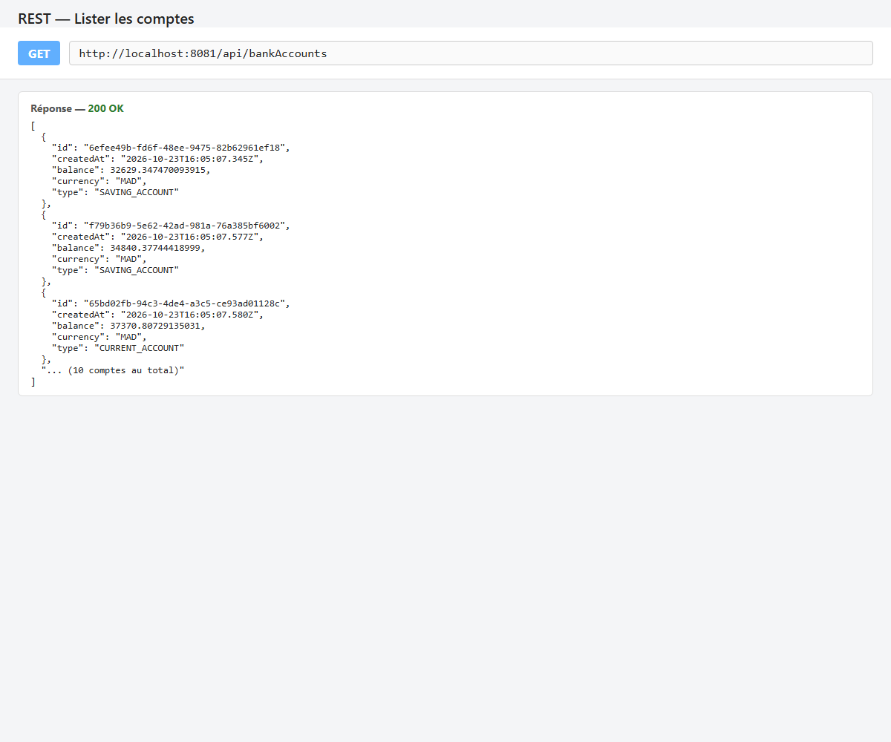

**Consulter un compte**

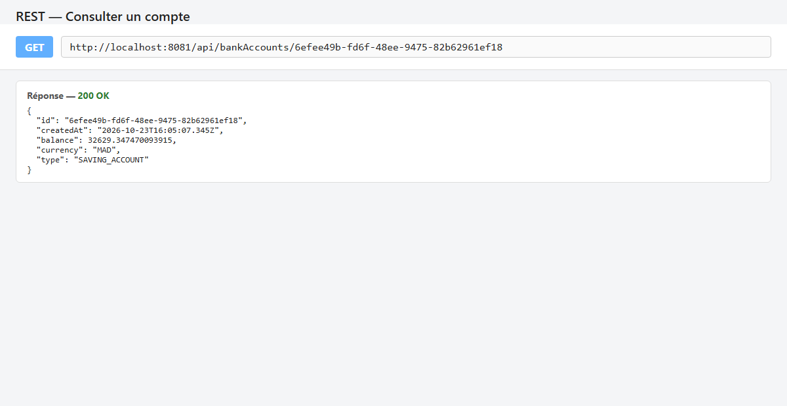

**Créer un compte**

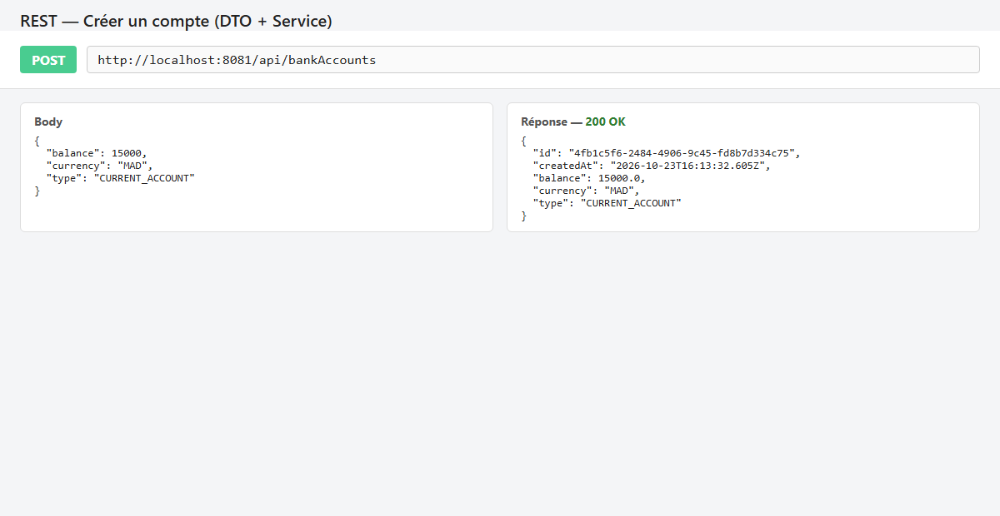

**Modifier un compte**

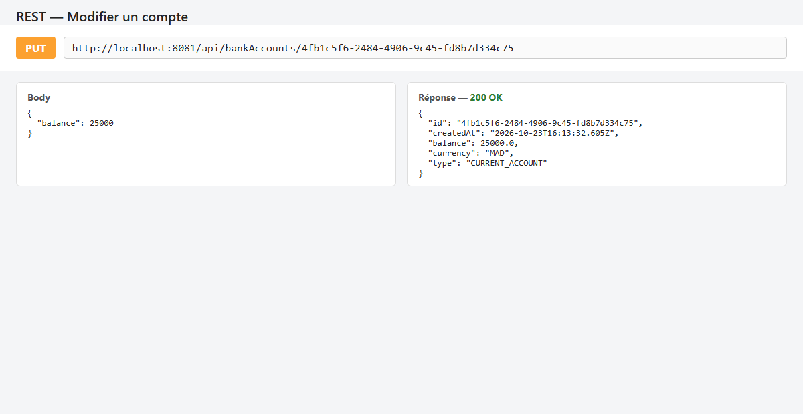

**Supprimer un compte**

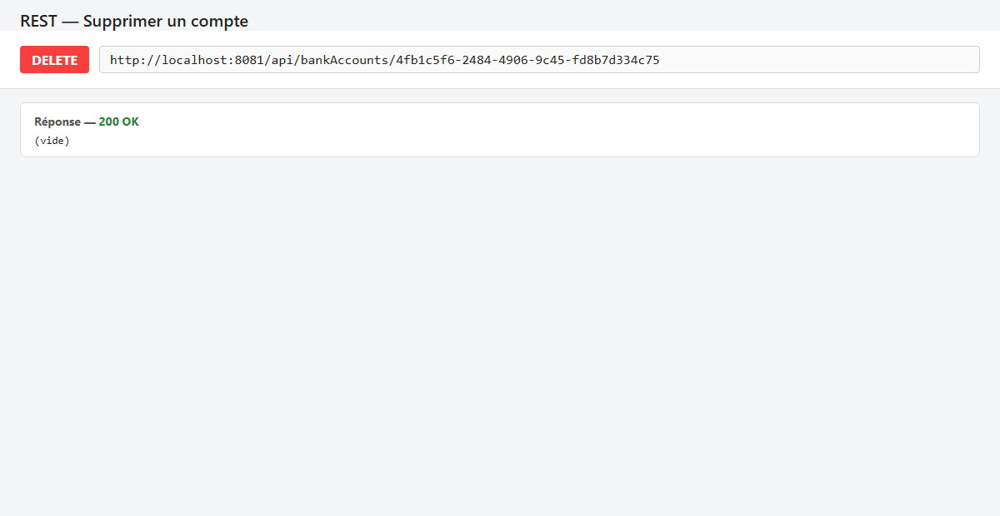

## 7. Documentation Swagger

Dépendance ajoutée :

```xml
<dependency>
    <groupId>org.springdoc</groupId>
    <artifactId>springdoc-openapi-starter-webmvc-ui</artifactId>
    <version>3.0.2</version>
</dependency>
```

La documentation est disponible sur `/swagger-ui/index.html` et la spécification OpenAPI sur `/v3/api-docs`.

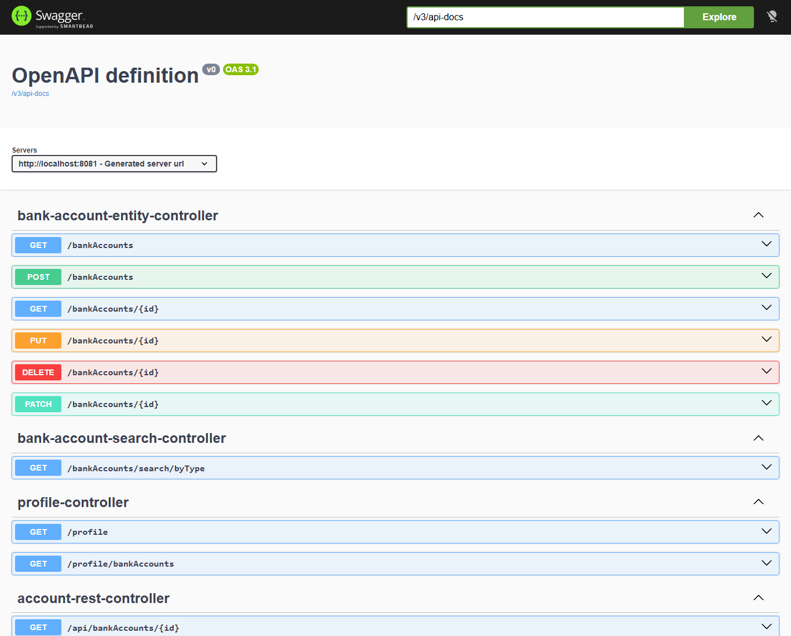

## 8. Spring Data REST et projections

Avec `spring-boot-starter-data-rest`, le repository est exposé automatiquement sur `/bankAccounts`.
La projection `p1` ne renvoie que l'id, le type et le solde :

```java
@Projection(types = BankAccount.class, name = "p1")
public interface AccountProjection {
    String getId();
    AccountType getType();
    Double getBalance();
}
```

**Liste avec la projection `p1`**

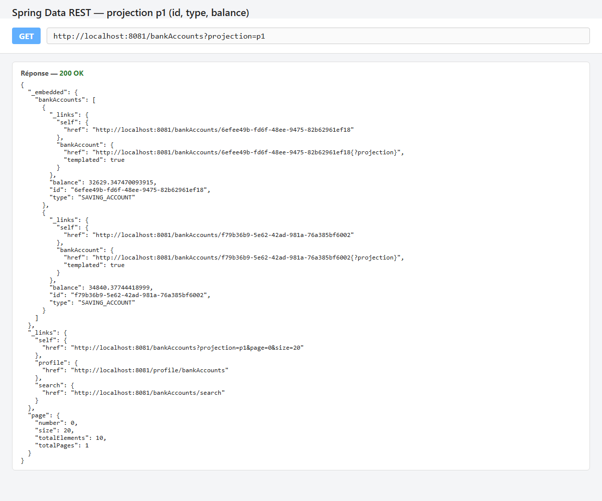

**Recherche par type**

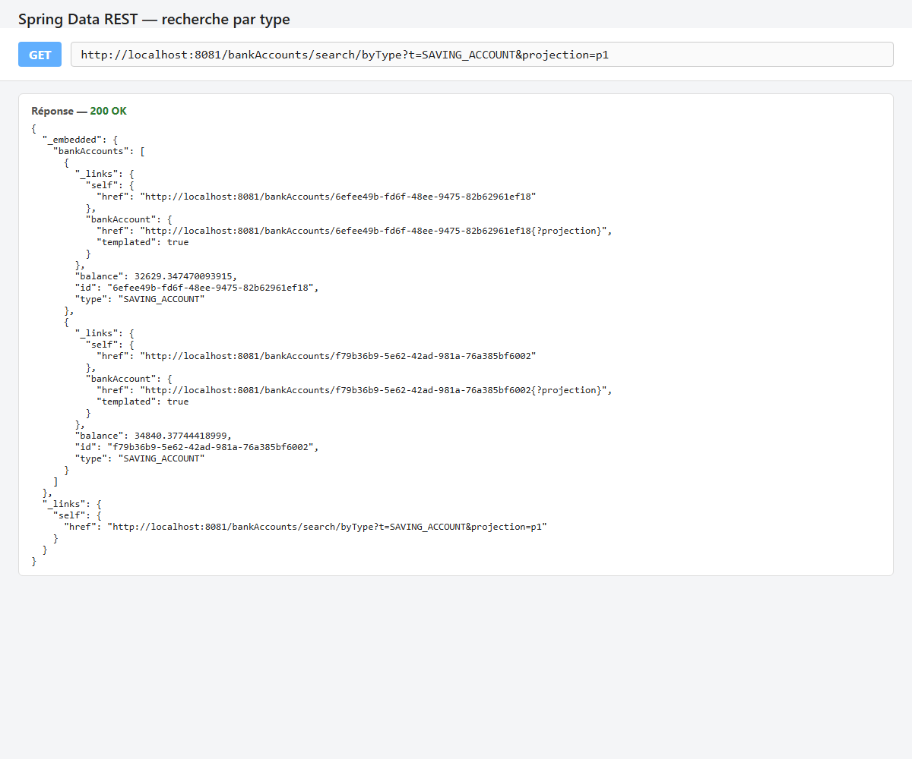

## 9. DTOs et Mappers

- `BankAccountRequestDTO` : données envoyées par le client (`balance`, `currency`, `type`).
- `BankAccountResponseDTO` : données renvoyées au client (avec `id` et `createdAt`).
- `AccountMapper` : convertit une entité en DTO avec `BeanUtils.copyProperties`.

```java
@Component
public class AccountMapper {
    public BankAccountResponseDTO fromBankAccount(BankAccount bankAccount) {
        BankAccountResponseDTO bankAccountResponseDTO = new BankAccountResponseDTO();
        BeanUtils.copyProperties(bankAccount, bankAccountResponseDTO);
        return bankAccountResponseDTO;
    }
}
```

## 10. Couche Service (métier)

```java
public interface AccountService {
    BankAccountResponseDTO addAccount(BankAccountRequestDTO bankAccountDTO);
    BankAccountResponseDTO updateAccount(String id, BankAccountRequestDTO bankAccountDTO);
}
```

`AccountServiceImpl` (`@Service @Transactional`) génère l'id et la date de création, enregistre le compte puis renvoie un DTO.
Les méthodes `POST` et `PUT` du contrôleur REST passent par ce service.

## 11. Web service GraphQL

Schéma `src/main/resources/graphql/schema.graphqls` :

```graphql
type Query {
    accountsList: [BankAccount]
    bankAccountById(id: String): BankAccount
}

type Mutation {
    addAccount(bankAccount: BankAccountDTO): BankAccount
    updateAccount(id: String, bankAccount: BankAccountDTO): BankAccount
    deleteAccount(id: String): Boolean
}

type BankAccount {
    id: String
    createdAt: String
    balance: Float
    currency: String
    type: String
}

input BankAccountDTO {
    balance: Float
    currency: String
    type: String
}
```

Le contrôleur `BankAccountGraphQLController` implémente les requêtes avec `@QueryMapping` et `@MutationMapping`.
`CustomDataFetcherExceptionResolver` renvoie au client le vrai message d'erreur.

**Interface GraphiQL** (`/graphiql`)

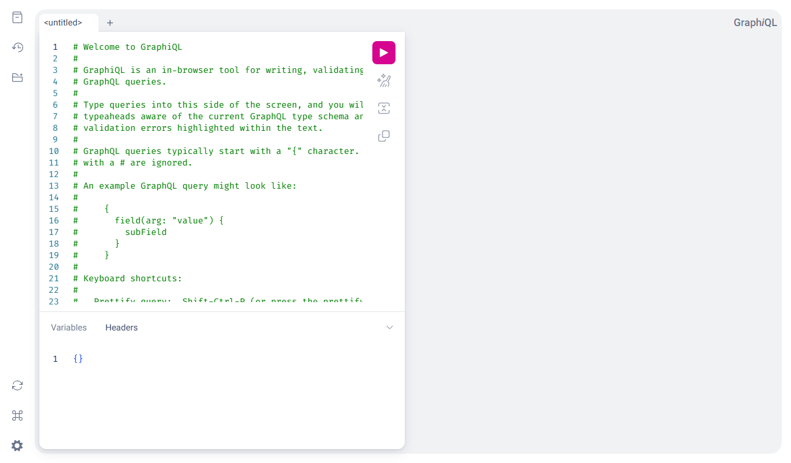

**Query `accountsList`**

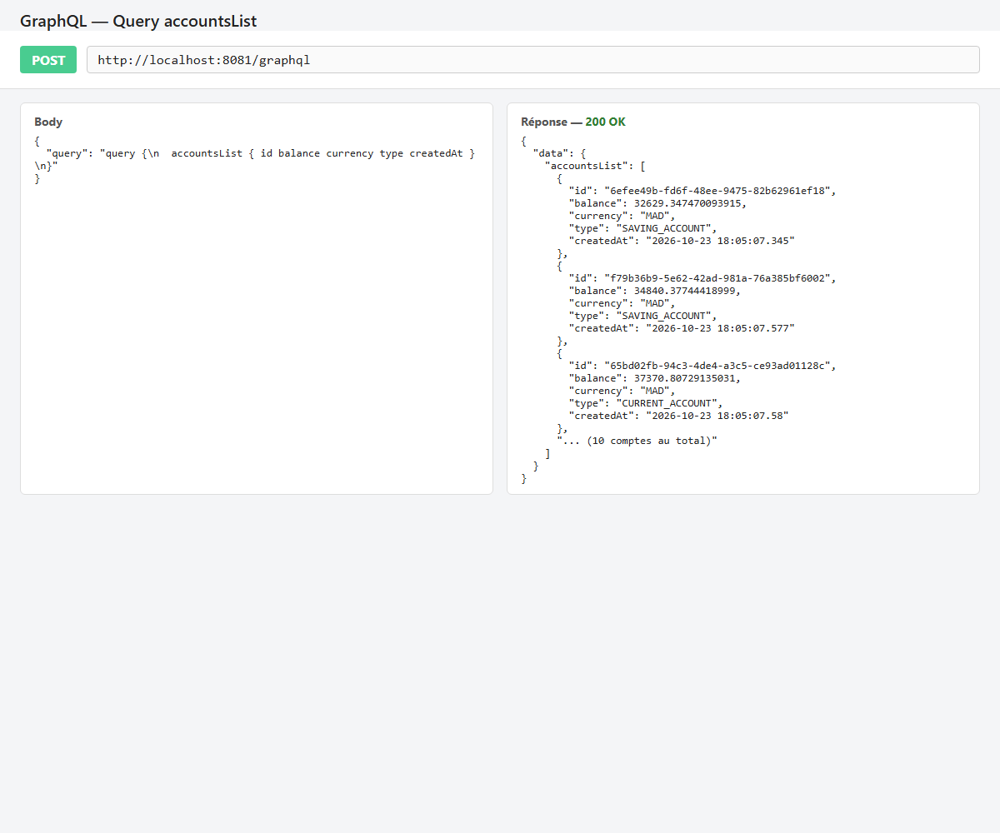

**Query `bankAccountById`**

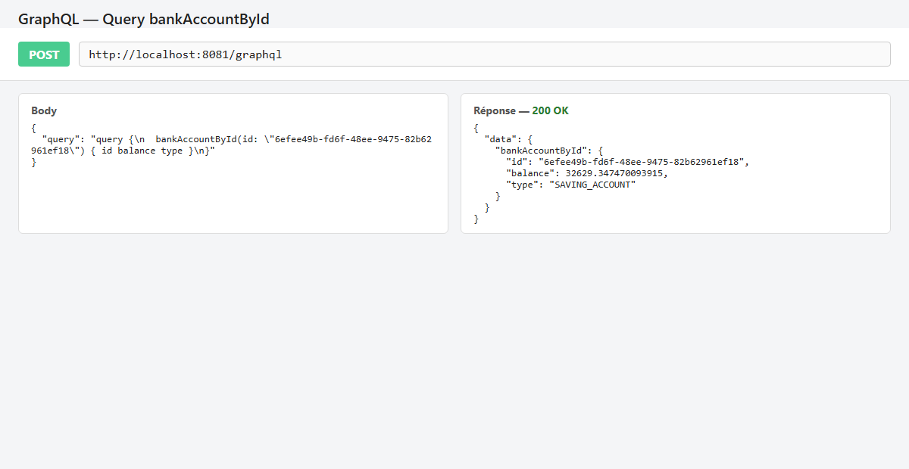

**Mutation `addAccount`**

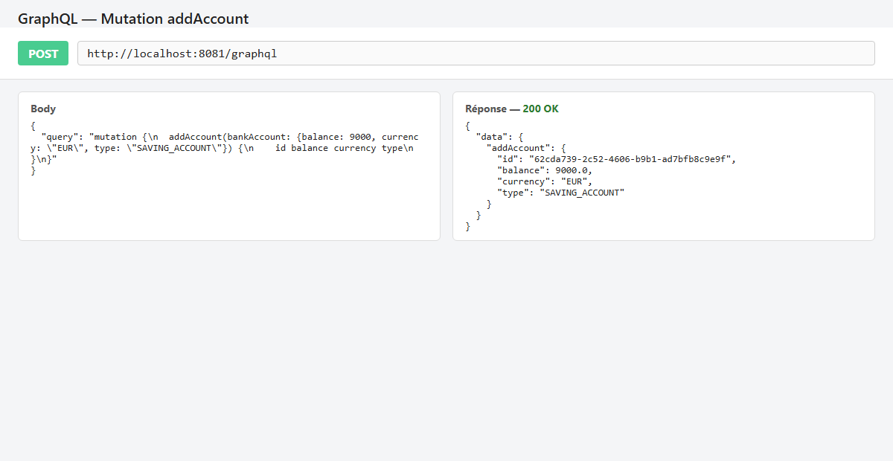

**Mutation `updateAccount`**

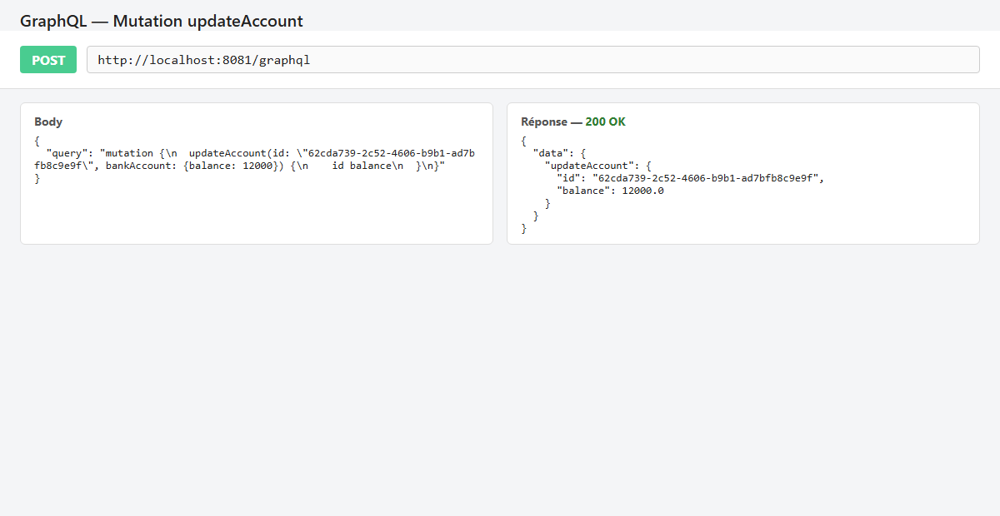

**Mutation `deleteAccount`**

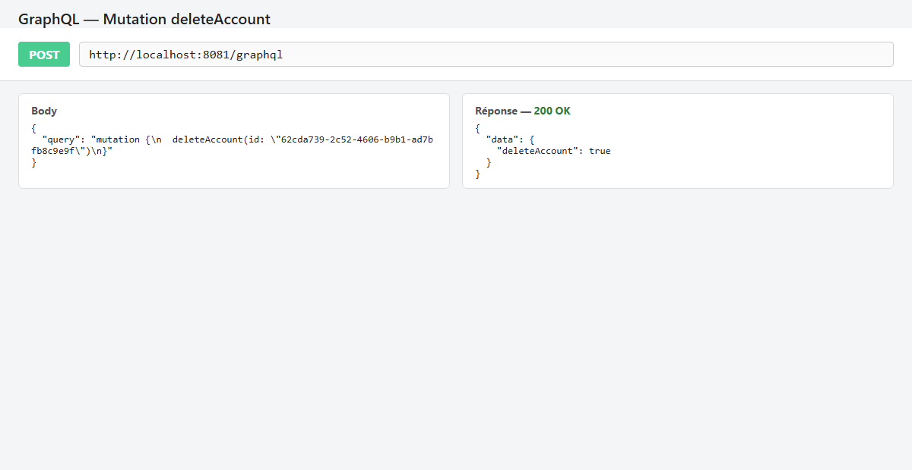

**Gestion des erreurs**

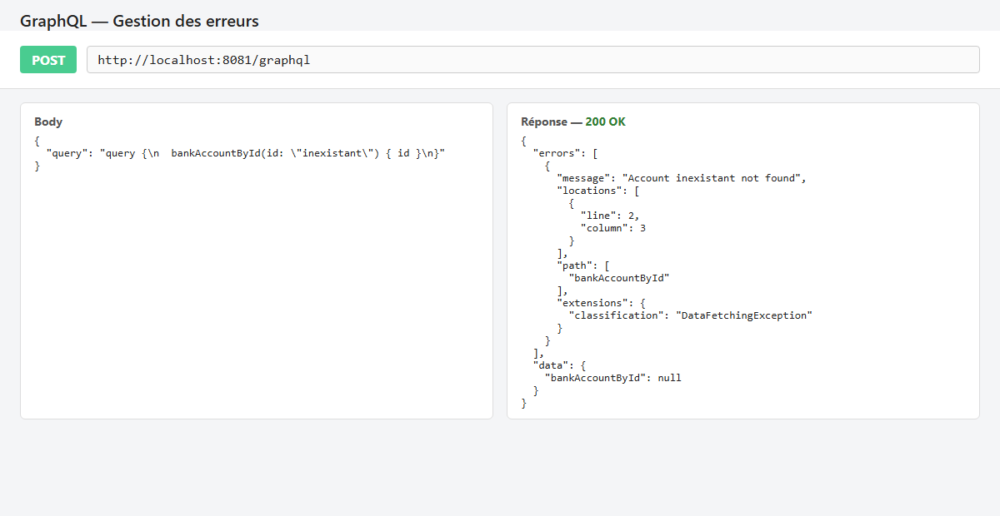

## Conclusion

Ce micro-service présente plusieurs façons d'exposer une même couche de données : un contrôleur REST classique documenté avec Swagger,
une API générée par Spring Data REST avec projections et un Web service GraphQL.
Les DTOs, les mappers et la couche service séparent le modèle de persistance des données échangées avec les clients.
